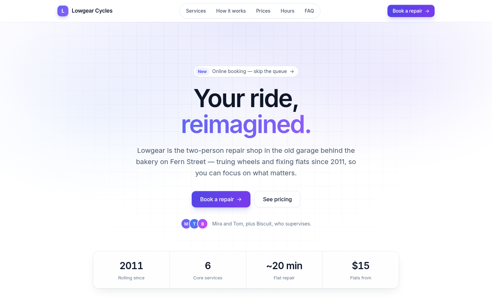
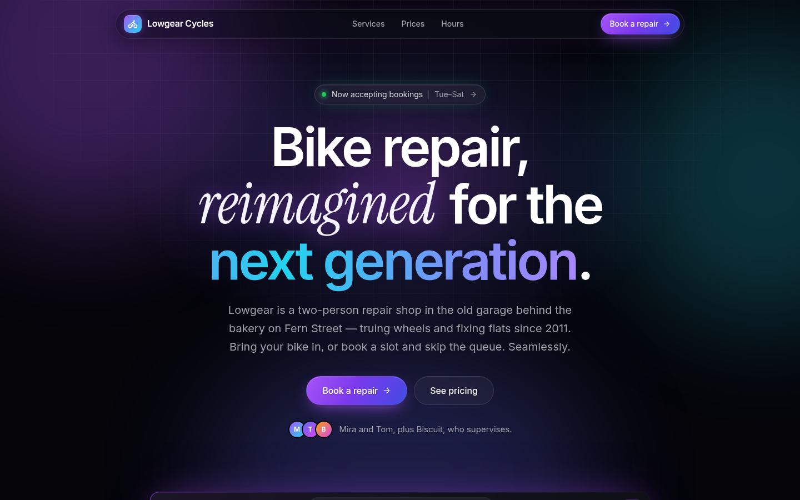

# Reslop

Make your website look AI-generated again.

You spent a weekend getting the slop out. Swapped Inter for a font with opinions. Deleted the purple gradient, the bento grid, the "✦ AI-powered" badge and the metrics nobody could source. It finally looks like a person made it.

Reslop puts it all back.

It's a Claude Code skill that restyles an existing frontend into the median AI landing page and leaves your routes, state and forms alone. We're ruining the design, not the code.

## Before / after

One small hand-written site, then each mode on top of it. The prices, the opening hours and the booking form survive all three.

| Before | classic |
| --- | --- |
|  |  |
| **hard** | **max** |
|  |  |

## Install

As a plugin, inside Claude Code:

```
/plugin marketplace add gabrielle-pch/reslop
/plugin install reslop@reslop
```

Or copy the skill folder:

```sh
git clone https://github.com/gabrielle-pch/reslop.git
cp -r reslop/skills/reslop ~/.claude/skills/
```

Put it in a project's `.claude/skills/` instead if you only want it there.

## Usage

Commit first. It edits a lot of files and you'll want a way back.

```
/reslop            classic
/reslop hard
/reslop max
/reslop score      read-only, rates what you've already got
```

**classic.** Believable. Inter, a centered hero with one gradient phrase, a pill badge above it, three nearly identical feature cards with icons in rounded squares, soft shadows, purple and blue. What you get when you ask for "a modern SaaS landing page" and nothing else.

**hard.** Obvious. Goes dark. Glass on everything, a floating pill navbar, blurred blobs, an italic serif word in every heading, a fake dashboard in a fake browser window, a bento grid, an infinite logo marquee, a pulsing "all systems operational" dot. 10x faster. Zero friction.

**max.** Terminal. All of the above on every component, plus neon borders, glossy orbs, orbits, a cursor glow, bentos inside bentos, three CTAs fighting each other and metrics like "300% More Future". This is the one for screenshots.

Anything after the mode gets passed along: `/reslop max but leave the blog alone`.

Installed as a plugin, the full name is `/reslop:reslop`. Plain `/reslop` works too unless something else already claims it.

It works with whatever the project already uses (Tailwind v3 or v4, CSS modules, plain CSS, styled-components, a component library) and doesn't install anything. Gradients are free.

## What it leaves alone

- Routes, state, data fetching, event handlers, form fields.
- Real content. Your prices are still your prices, even in a section called "Investment Tiers for the Mobility Singularity".
- Your dependencies.
- The truth. Invented metrics and testimonials are written to be obviously fake. Nobody should read "∞ Productivity" and think you measured it.
- `prefers-reduced-motion`. Even max sits still if you ask it to.

## Slop score

`/reslop score` doesn't change anything. It checks the code against 17 patterns with fixed points (purple gradients 10, gradient text 8, glassmorphism 8, and so on, all in [`score.md`](skills/reslop/references/score.md)) and only counts what it can point to in a file. It's a joke, but the rubric is real. The output looks like this:

```
RESLOP ANALYSIS

Slop Score: 87/100

✓ Purple gradients      10   src/app/page.tsx:12
✓ Glassmorphism          8   src/components/Nav.tsx:8
...
✗ Infinite marquee       0

Verdict: Almost indistinguishable from a one-shot Claude landing page.
```

## License

MIT

The slop must go on.
