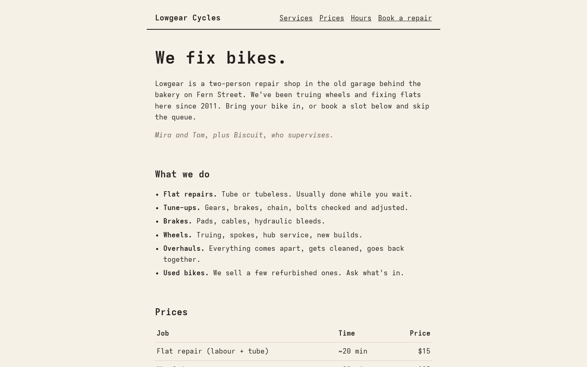
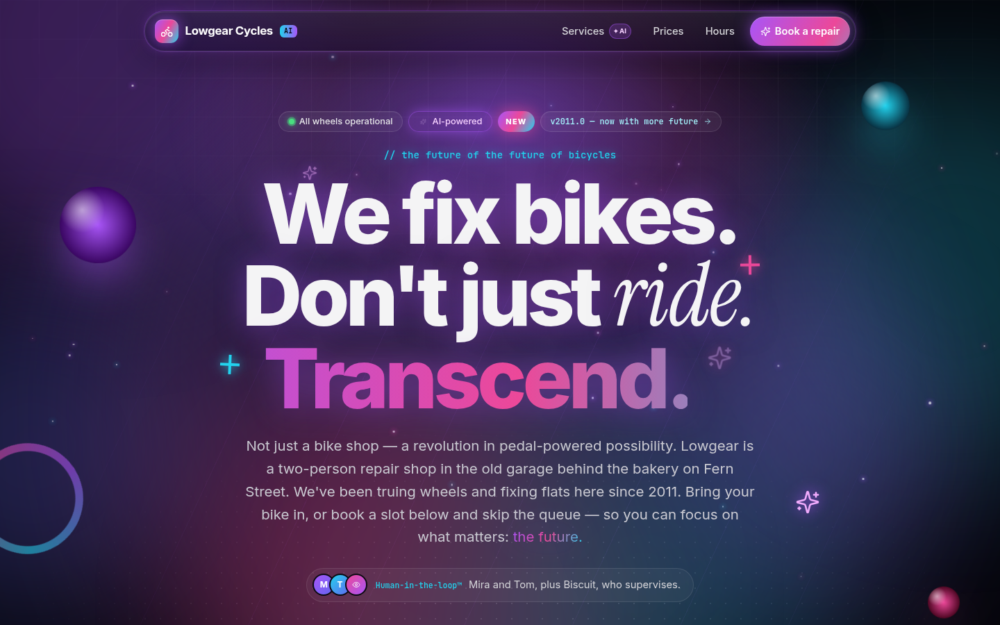

# Reslop

Make your website look AI-generated again.

You spent a weekend getting the slop out. Swapped Inter for a font with opinions. Deleted the purple gradient, the bento grid, the "✦ AI-powered" badge and the metrics nobody could source. It finally looks like a person made it.

Reslop puts it all back. Or something just like it.

It's a Claude Code skill that restyles an existing frontend into an AI landing page and leaves your routes, state and forms alone. Not the same AI landing page every time: there are many flavors of slop, and each run picks one. We're ruining the design, not the code.

## Before / after

One small hand-written site, then each mode on top of it. The prices, the opening hours and the booking form survive all three.

These were made back when every run came out purple. Now each run rolls its own flavor, so the same command might give you cream and serif, neo-brutalist, terminal green or something else entirely. The intensity is what carries over.

| Before | classic |
| --- | --- |
|  |  |
| **hard** | **max** |
|  |  |

## Install

As a plugin, inside Claude Code:

```
/plugin marketplace add gabrielle-pch/reslop
/plugin install reslop@reslop
```

Or copy the skill folder:

```sh
git clone https://github.com/gabrielle-pch/reslop.git
cp -r reslop/skills/reslop ~/.claude/skills/
```

Put it in a project's `.claude/skills/` instead if you only want it there.

## Usage

Commit first. It edits a lot of files and you'll want a way back.

```
/reslop            classic
/reslop hard
/reslop max
/reslop score      read-only, rates what you've already got
```

The modes are intensities. The look comes from the flavor (below).

**classic.** Believable. Generic, tidy, slightly soulless: a label above the headline, one treated phrase in it, three nearly identical cards with icons in tiles, the same section rhythm all the way down. What you get when you ask for "a modern website" once and ship it.

**hard.** Obvious. The same direction after someone asked for "more premium, modern, futuristic and AI-powered" five times: the signature effect on everything, decoration on every section, a mockup that explains nothing, a metrics band, the CTA three times. Doesn't have to be dark. 10x faster. Zero friction.

**max.** Unrecoverable. The direction with the restraint taken out: set pieces nested inside set pieces, features renamed as fictional products, three CTAs fighting each other, metrics like "300% More Future". This is the one for screenshots.

Anything after the mode gets passed along: `/reslop max but leave the blog alone`.

Installed as a plugin, the full name is `/reslop:reslop`. Plain `/reslop` works too unless something else already claims it.

It works with whatever the project already uses (Tailwind v3 or v4, CSS modules, plain CSS, styled-components, a component library) and doesn't install anything. Gradients are free.

## Flavors

Before it touches anything, Reslop reads the site, rolls dice for a flavor, a hero layout, a page structure and a set piece, and writes a short brief it then sticks to. Some of the flavors it knows:

indigo SaaS · aurora glass · dev-tool noir · warm editorial · neo-brutalist · pastel mesh · trust blue · terminal · holo Y2K · luxe noir · keynote bento · acid startup

So two `/reslop hard` runs can come back with completely different layouts, palettes, type and set pieces (a split hero over a versus table on cream paper, a console hero orbiting a logo on black) and both still look unmistakably generated. Every flavor keeps the tells: the label over the headline, the one treated phrase, the identical cards, the fade-ups, the em dashes, the fictional logos.

Want a particular one? Ask: `/reslop hard brutalist`, `/reslop max terminal`, `/reslop classic but keep it dark`.

## What it leaves alone

- Routes, state, data fetching, event handlers, form fields.
- Real content. Your prices are still your prices, even in a section called "Investment Tiers for the Mobility Singularity".
- Your dependencies.
- The truth. Invented metrics and testimonials are written to be obviously fake. Nobody should read "∞ Productivity" and think you measured it.
- `prefers-reduced-motion`. Even max sits still if you ask it to.

## Slop score

`/reslop score` doesn't change anything. It checks the code against 17 patterns with fixed points (purple gradients 10, gradient text 8, glassmorphism 8, and so on, all in [`score.md`](skills/reslop/references/score.md)) and only counts what it can point to in a file. It's a joke, but the rubric is real. It was written for the purple flavor, so a run in another flavor can be every bit as generated and still score lower. The output looks like this:

```
RESLOP ANALYSIS

Slop Score: 87/100

✓ Purple gradients      10   src/app/page.tsx:12
✓ Glassmorphism          8   src/components/Nav.tsx:8
...
✗ Infinite marquee       0

Verdict: Almost indistinguishable from a one-shot Claude landing page.
```

## License

MIT

The slop must go on.
